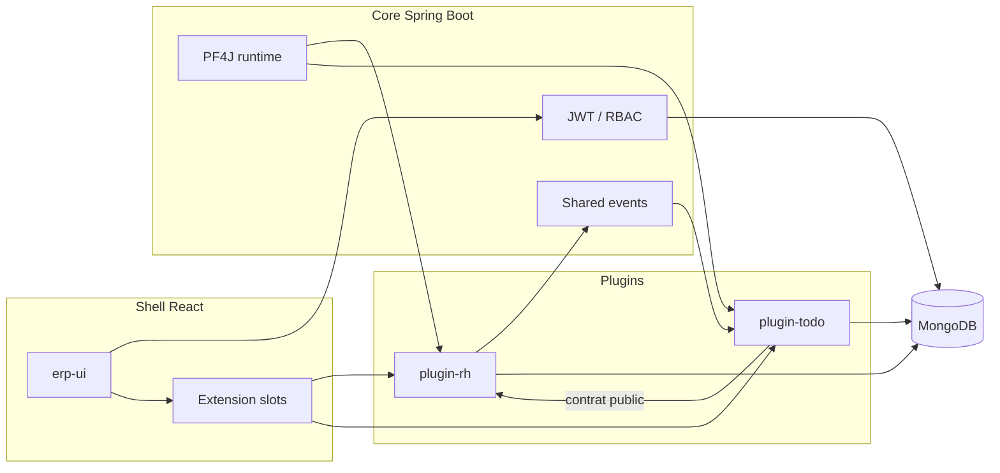

# pf4-erp

ERP modulaire : un core Spring Boot charge des plugins métier Java (PF4J) et leur interface React, sans recompiler le socle.

Projet personnel de démonstration. L’objectif est de montrer une architecture extensible — hexagonale, plugins isolés, micro-frontends, droits d’accès — sur un périmètre volontairement réduit (RH et tâches).

## Ce que le dépôt montre

- **Architecture hexagonale** : le domaine ne dépend ni de Spring, ni de MongoDB, ni de HTTP. Les use cases parlent à des ports.
- **Plugins hybrides** : un JAR embarque le code Java, le manifeste `plugin.yaml` et le bundle UI (`main.js` / `style.css`).
- **Micro-frontends** : le shell React découvre les plugins actifs et monte leurs écrans dans des slots (`menu.main`, `dashboard.widgets`).
- **Contrats entre modules** : Todo consomme l’API publique de RH (`EmployeDirectory`) et réagit à ses événements, sans dépendre de son implémentation.
- **RBAC** : chaque plugin déclare ses permissions. Le core les expose aux rôles et les porte dans le JWT.
- **Deux modes d’exécution** : développement (classes du plugin) et déploiement (JAR dans `plugins/`), plus une stack Docker.

## Stack

| Couche | Choix |
|--------|--------|
| Backend | Java 21, Spring Boot 3.4, Maven multi-modules |
| Plugins | PF4J 3.12, pf4j-spring |
| Architecture | Hexagonale (ports & adapters) |
| Auth | JWT (jjwt) + RBAC |
| Persistance | MongoDB (adapter). PostgreSQL reste possible derrière les mêmes ports |
| Frontend | React, TypeScript, Vite, Tailwind, shadcn/ui |
| Livraison | Docker Compose (core, UI nginx, MongoDB) |

## Architecture



```
pf4-erp/
├── erp-plugin-api/    # Contrats du core (extensions, événements)
├── plugin-rh-api/     # Contrats publics RH
├── erp-core/          # Shell Spring, PF4J, auth, RBAC
├── plugin-rh/         # Employés + UI
├── plugin-todo/       # Projets et tâches, branché sur RH
├── erp-ui/            # Shell React
├── plugins/           # JARs en mode déploiement
├── deploy/            # Docker Compose, Dockerfiles, scripts
└── docs/              # Architecture et décisions
```

## Démarrage rapide

Prérequis : JDK 21, Maven 3.9, Node.js 20, Docker.

```bash
docker compose up -d
# MongoDB  mongodb://localhost:27017/pf4erp

cd plugin-rh/ui && npm install && npm run build && cd ../..
cd plugin-todo/ui && npm install && npm run build && cd ../..

mvn -q clean package -DskipTests

cd erp-ui && npm install && npm run dev
# UI de dev : http://localhost:5173  (proxy /api vers :8080)
```

Dans un autre terminal :

```bash
mvn -pl erp-core spring-boot:run
```

Stack complète (Mongo + core en mode déploiement + UI nginx) :

```bash
cp deploy/.env.example deploy/.env   # optionnel
./deploy/scripts/up.sh
# UI       http://localhost:3000
# Core     http://localhost:8080
# Swagger  http://localhost:3000/swagger-ui.html
```

| Variable | Défaut | Rôle |
|----------|--------|------|
| `MONGODB_URI` | `mongodb://localhost:27017/pf4erp` | Base Mongo |
| `JWT_SECRET` | secret de démo, local uniquement | Signature JWT. À remplacer hors machine de dev |
| `PLUGIN_RUNTIME_MODE` | `development` | `development` ou `deployment` |
| `PLUGINS_DIR` | `./plugins` | JARs en mode déploiement |

Comptes seedés au premier démarrage :

| Utilisateur | Mot de passe | Rôle |
|-------------|--------------|------|
| `admin` | `admin` | ADMIN — toutes les permissions |
| `user` | `user` | USER — lecture employés et ses propres tâches |

Le seed crée aussi un rôle `TASK_MANAGER` (gestion des projets et des tâches, lecture des employés).

## Documentation

| Document | Contenu |
|----------|---------|
| [docs/CORE_ARCHITECTURE.md](docs/CORE_ARCHITECTURE.md) | Architecture du core |
| [docs/PLUGIN_INTERACTION.md](docs/PLUGIN_INTERACTION.md) | Contrats, extensions et événements entre plugins |
| [docs/DECISIONS.md](docs/DECISIONS.md) | Décisions d’architecture |

## Auteur

Ismael KABORE — projet personnel, publié pour montrer la façon de structurer un produit modulaire.

## Licence

[MIT](LICENSE)
